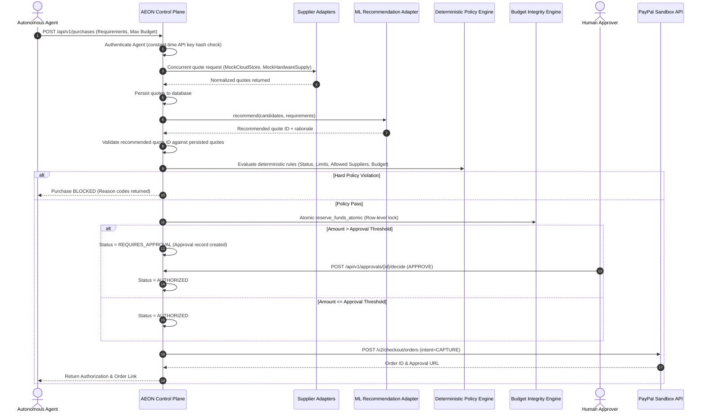

# AEON Backend Architecture & System Design

## 1. Executive Overview

**AEON** is an Agent Procurement Control Plane governing autonomous transactions initiated by AI agents.

### Central Architectural Tenet
> **"ML Recommends, but AEON Authorizes."**
> Machine learning models assist in comparing suppliers and recommending optimal quotes, but no ML model output may override deterministic financial, organizational, or security policies.

---

## 2. High-Level Modular Monolith Architecture

AEON is constructed as a high-performance modular monolith using **FastAPI**, **SQLAlchemy 2.x async**, and **Pydantic v2**.

```mermaid
flowchart TD
    Agent[Autonomous AI Agent] -->|X-Agent-API-Key| Gateway[FastAPI API Gateway]
    Admin[Dashboard Admin] -->|Bearer JWT| Gateway
    Vercel[Vercel Frontend] -->|REST API| Gateway

    subgraph AEON Modular Monolith
        Gateway --> Auth[Identity & Security Engine]
        Gateway --> Proc[Procurement Pipeline Service]
        Gateway --> Policy[Deterministic Policy Engine]
        Gateway --> Budget[Budget & Reservation Engine]
        Gateway --> Payment[PayPal Orders v2 Service]
        Gateway --> Audit[Append-Only Audit Ledger]

        Proc --> ML[ML Recommendation Adapter]
        Proc --> Supp[Supplier Registry & Adapters]
    end

    ML --> AeonML[aeon_ml Hybrid ML Ranker]
    Supp --> MockA[MockCloudStore]
    Supp --> MockB[MockHardwareSupply]
    Payment --> PayPal[PayPal Sandbox Orders v2]
    AEON Modular Monolith --> DB[(Supabase PostgreSQL)]
```

---

## 3. End-to-End Procurement Flow



---

## 4. Lifecycle State Machines

To prevent ambiguous states, **Purchase**, **Payment**, and **Fulfillment** lifecycles are decoupled:

### Purchase Lifecycle
`REQUESTED` $\rightarrow$ `QUOTING` $\rightarrow$ `RECOMMENDED` $\rightarrow$ (`BLOCKED` | `REQUIRES_APPROVAL` | `AUTHORIZED`) $\rightarrow$ (`CANCELLED` | `COMPLETED`)

### Payment Lifecycle
`NOT_STARTED` $\rightarrow$ `ORDER_CREATED` $\rightarrow$ `BUYER_APPROVAL_PENDING` $\rightarrow$ `CAPTURE_PENDING` $\rightarrow$ `COMPLETED` | `FAILED` | `REFUNDED`

### Fulfillment Lifecycle
`NOT_STARTED` $\rightarrow$ `PENDING` $\rightarrow$ `DELIVERED` | `FAILED`

---

## 5. Budget Integrity & Concurrency

- **Formula**: `Available Budget = Allocated Amount - Reserved Amount - Spent Amount`
- **Atomic Reservations**: Row-level locking with `SELECT ... FOR UPDATE` prevents concurrent race conditions and double-spending across autonomous agents.
- **Settle vs. Release**:
  - Payment capture success: Settle reservation (`reserved -= amount`, `spent += amount`).
  - Payment failure or human rejection: Release reservation (`reserved -= amount`).
  - Refund: Record reversal transaction and refund budget (`spent -= amount`).
