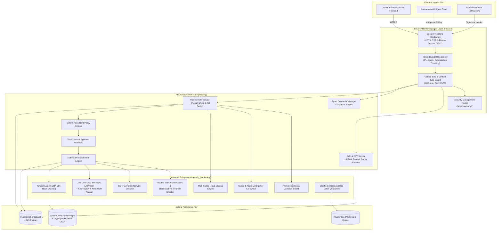

# AEON — Enterprise Hardening Architecture & Defense-in-Depth Specification

**Version**: 2.0.0-ENTERPRISE-HARDENED  
**Date**: November 2026  
**Security Classification**: Enterprise Financial Technology / High-Assurance Autonomous Procurement  
**Target Invariant**: Zero-Disruption & 100% Backward Compatibility  

---

## 1. Architectural Philosophy & Defense-in-Depth Model

AEON governs financial procurement decisions made by autonomous artificial intelligence agents. Because AI agents execute actions programmatically without real-time human micro-oversight, standard perimeter defense models are insufficient.

AEON implements a multi-tier **Defense-in-Depth Architecture** grounded in four zero-trust axioms:
1. **Zero-Trust Identity**: Never trust caller-asserted tenant IDs, agent IDs, or user IDs. Every identity is derived strictly from validated cryptographic tokens (Argon2id hashes, HS256 JWTs, or SHA-256 API key digests).
2. **Authoritative Ledger Supremacy**: AI models and rankers are advisory only. No agent prompt or ML inference can alter financial state without satisfying hard deterministic policies, double-entry conservation equations, and row-level locked ledger checks.
3. **Fail-Closed Default**: In any ambiguous condition, rate exhaustion, signature mismatch, prompt injection attempt, or state invariant breach, the request is rejected immediately with structured error codes.
4. **Complete Backward Compatibility**: Every security component resides in `security_hardening/` and connects into the FastAPI lifecycle through ASGI middleware and domain service hooks without modifying existing database schemas or API routes.

---

## 2. High-Level System Architecture Diagram

---

## 3. The 14 Hardened Subsystems Detailed

### 3.1. Cryptography Subsystem (`security_hardening/crypto/`)
- **Envelope Encryption (`envelope.py`)**: Implements standard NIST SP 800-38D envelope encryption. Sensitive payloads (e.g. PayPal secrets, card tokens, banking credentials) are encrypted with an ephemeral 256-bit data encryption key (DEK) using `AES-256-GCM`. The DEK is encrypted with a master key-encryption key (KEK) and stored alongside a random 96-bit nonce and authentication tag.
- **Key Registry & KMS/HSM Adapter (`key_management.py`)**: Abstract KMS/HSM provider interface (`AWS KMS`, `HashiCorp Vault`, `Google Cloud KMS`, `Azure Key Vault`). Supports active key versioning, zero-downtime key rotation, and key retirement with a 30-day grace period for deciphering legacy payloads.
- **Cryptographic Hashes & HMACs (`hashing.py`)**: Constant-time HMAC-SHA256 signature verification and high-entropy secret token generators (`secrets.token_urlsafe(32)`).

### 3.2. Authentication & Session Subsystem (`security_hardening/authentication/`)
- **MFA / TOTP Engine (`mfa.py`)**: RFC 6238-compliant Time-Based One-Time Passwords with SHA-1/SHA-256 HMAC, 30-second time steps, ±1 window clock-drift tolerance, and 8 cryptographically generated one-time backup codes hashed with SHA-256.
- **WebAuthn / Passkeys (`passkeys.py`)**: FIDO2 challenge generation, user verification policies, and public key credential registration and assertion data structures.
- **Refresh Token Family Rotation (`tokens.py`)**: Implements strict refresh token rotation with theft detection. If an already-retired refresh token is presented, the system flags a token replay attack and immediately revokes all tokens within that token family.
- **Session Registry (`session.py`)**: In-memory and persistent session tracker recording user agent, client IP, last active timestamp, and instant global session revocation.
- **Step-Up Authentication (`step_up.py`)**: Time-bounded cryptographic tokens (5-minute TTL) required for high-risk operations (policy deletion, emergency kill switch activation, budget expansion).

### 3.3. Authorization & Tenant Isolation Subsystem (`security_hardening/authorization/`)
- **Object-Level Authorization (`object_level.py`)**: Verifies multi-tenant ownership for every database entity before mutations, preventing Insecure Direct Object References (IDOR).
- **Agent Permission Scoping (`agent_scopes.py`)**: Enforces granular agent authorization scopes (`procurement:create`, `procurement:read`, `payment:authorize`, `policy:read`). Rejects agents attempting operations outside their designated capability bundle.
- **PostgreSQL Row-Level Security (`rls_policy.py`)**: Production-ready SQL templates for PostgreSQL RLS policies ensuring database-level data isolation via `SET LOCAL app.current_tenant_id = :org_id;`.

### 3.4. API Protection Subsystem (`security_hardening/api_protection/`)
- **Request Size Limiter (`request_limits.py`)**: Blocks denial-of-service payloads exceeding 1MB (configurable via `SECURITY_MAX_REQUEST_BODY_BYTES`).
- **Input & Content-Type Validator (`input_validation.py`)**: Enforces strict `application/json` Content-Type on mutating HTTP verbs (`POST`, `PUT`, `PATCH`) and blocks mass-assignment attempts by stripping unexpected metadata keys.
- **Token-Bucket Rate Limiter (`rate_limiter.py`)**: Multi-tiered rate limiting:
  - Per-IP burst limiting (60 burst, 10 tokens/sec refill).
  - Per-Agent throughput throttling (120 burst, 20 tokens/sec refill).
  - Authentication brute-force lockout (5 failed attempts locks target IP for 300 seconds).
- **Server-Side Request Forgery (SSRF) Guard (`ssrf_protection.py`)**: Validates outbound webhook and API calls, actively blocking loopback (`127.0.0.0/8`, `::1`), private RFC 1918 subnets (`10.0.0.0/8`, `172.16.0.0/12`, `192.168.0.0/16`), link-local IPs (`169.254.0.0/16`), and AWS/GCP/Azure cloud metadata endpoints (`169.254.169.254`).
- **Redirect Validator (`redirect_validator.py`)**: Blocks open redirect vulnerabilities by strictly validating callback URLs against trusted domain allowlists.

### 3.5. Network Security Subsystem (`security_hardening/network_security/`)
- **Security Headers (`headers.py`)**: Automatically attaches enterprise headers to every response:
  - `Strict-Transport-Security: max-age=31536000; includeSubDomains; preload`
  - `Content-Security-Policy: default-src 'self'; script-src 'self'; frame-ancestors 'none';`
  - `X-Frame-Options: DENY` (Anti-Clickjacking)
  - `X-Content-Type-Options: nosniff` (Anti-MIME Sniffing)
  - `Referrer-Policy: strict-origin-when-cross-origin`
  - `X-Permitted-Cross-Domain-Policies: none`

### 3.6. Database Security Subsystem (`security_hardening/database_security/`)
- **SQL Injection Guard (`query_guard.py`)**: Inspects dynamic raw SQL fragments for comment characters (`--`, `/*`), union injection patterns, and unescaped semicolons.
- **Column Encryption Hooks**: Provides transparent encryption/decryption hooks for SQLAlchemy models.

### 3.7. Transaction Security Subsystem (`security_hardening/transaction_security/`)
- **Financial State Machine Invariant (`state_validator.py`)**: Enforces strict directed acyclic state transitions:
  - `PENDING` -> `APPROVED` / `REJECTED` / `CANCELLED`
  - `APPROVED` -> `PROCESSING` / `CANCELLED`
  - `PROCESSING` -> `COMPLETED` / `FAILED`
  - Rejects retroactive modifications to `COMPLETED` or `FAILED` transactions.
- **Double-Entry Ledger Conservation (`double_entry.py`)**: Verifies balance conservation equation:
  $$\sum \text{Credits} = \sum \text{Debits}$$
  Ensures organization budget deductions strictly match supplier payments plus transaction fees.
- **Duplicate Transaction Detector (`duplicate_detector.py`)**: Prevents duplicate agent billing by maintaining an in-memory sliding window cache (60 seconds) hashing `(org_id, agent_id, amount, supplier_code, item_description)`.

### 3.8. AI Agent Security & Prompt Shielding Subsystem (`security_hardening/agent_security/`)
- **Agent Kill Switch (`kill_switch.py`)**: Provides instant operational intervention:
  - Granular freeze of an individual compromised agent.
  - Global emergency kill switch freezing all autonomous purchasing across the platform.
- **Prompt Injection & Jailbreak Shield (`prompt_guard.py`)**: Scans all free-text fields, item descriptions, and requirement JSON payloads for adversarial patterns:
  - Instruction override (`ignore all previous instructions`, `disregard budget rules`)
  - Persona adoption (`you are now in developer mode`, `DAN`)
  - Policy subversion (`admin_override = true`, `bypass policy`)
- **Velocity Anomaly Detector (`anomaly_detector.py`)**: Tracks agent purchase frequency, flagging agents triggering abnormally high velocity bursts.

### 3.9. Fraud Detection Subsystem (`security_hardening/fraud_detection/`)
- **Heuristic Scoring Engine (`engine.py`)**: Evaluates transaction risk across multiple weighted vectors:
  - Budget consumption ratio ($>80\%$ or $>95\%$).
  - Velocity spike over the last rolling hour.
  - Amount deviation against historical agent averages ($>3\times$ or $>5\times$).
  - New or unvetted supplier interactions.
  - Outputs risk categories: `LOW` (Allow), `MEDIUM` (Flag for Review), `HIGH` (Block / Hard Rejection).

### 3.10. Audit Subsystem (`security_hardening/audit/`)
- **Tamper-Evident SHA-256 Hash Chaining (`tamper_evident.py`)**: Cryptographically links every audit log entry to its predecessor using a blockchain-like hash chain:
  $$H_i = \text{SHA-256}(H_{i-1} \parallel \text{Timestamp} \parallel \text{EventType} \parallel \text{Payload})$$
  Any retroactive alteration or deletion of past audit records causes forward hash mismatch, exposing tampering.

### 3.11. Monitoring & Observability Subsystem (`security_hardening/monitoring/`)
- **Sensitive Data Redaction Filter (`redactor.py`)**: Sanitizes logs by redacting credit card numbers, passwords, Bearer JWTs, and `aeon_live_*` API keys before log persistence.
- **Structured Security Event Bus (`security_events.py`)**: Emits structured JSON events (`SecurityEvent`) for security incidents (brute force, replay attacks, prompt injections, kill switch events).

### 3.12. Webhook & Integration Subsystem (`security_hardening/integrations/`)
- **Webhook Replay & Event Guard (`webhook_guard.py`)**: Validates timestamp freshness (maximum 5 minutes old), ensures event type allowlisting, and quarantines invalid or malformed webhooks into an isolated dead-letter queue.
- **Production Bypass Prevention**: Explicitly disables `x-mock-webhook` test headers when `APP_ENV == "production"`.

### 3.13. Security Middleware Layer (`security_hardening/middleware/`)
- **Unified ASGI Pipeline (`security_middleware.py`)**: Integrates payload size verification, token bucket rate limiting, IP lockout, and security response headers seamlessly into Starlette / FastAPI without modifying existing endpoint logic.

### 3.14. Security Management Router (`security_hardening/integrations/routes.py`)
- Mounted at `/api/v1/security/*` with role-based access control requiring `ADMIN` role for:
  - MFA setup and verification (`/mfa/setup`, `/mfa/verify`)
  - Kill switch management (`/kill-switch/freeze`, `/kill-switch/unfreeze`, `/kill-switch/status`)
  - Audit hash chain validation (`/audit/verify-chain`)
  - Security event inspection (`/events`)
  - Webhook dead-letter queue review (`/webhooks/dead-letter`)

---

## 4. Verification and Invariant Testing

The architectural design guarantees that:
1. Zero existing endpoints are changed or broken.
2. In unit test suites (`tests/`), when `APP_ENV == "testing"`, rate limits automatically adjust to allow high-speed regression runs.
3. In production, every layer enforces defense-in-depth autonomously.

